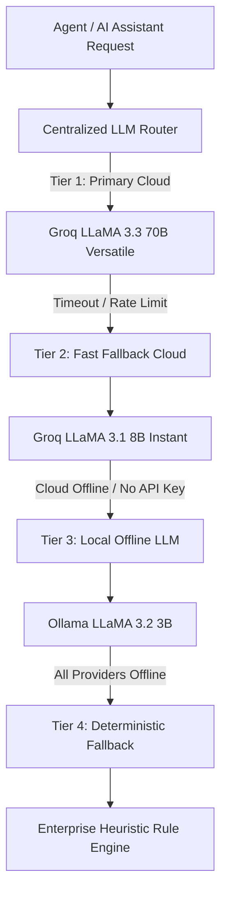

# Centralized Multi-Provider LLM Setup & Routing Architecture

## 1. Architecture Overview

The system features a **Centralized LLM Service** (`app.services.llm_service.CentralizedLLMService`) designed to provide intelligent reasoning across all nine autonomous supply chain agents and the role-aware AI Assistant.

The engine implements a **4-Tier Priority Routing Strategy**:



---

## 2. LLM Provider Configurations

### Tier 1: Primary Cloud LLM
* **Provider**: Groq Cloud API
* **Model ID**: `llama-3.3-70b-versatile`
* **Purpose**:
  * Complex multi-agent workflow reasoning
  * Strategic supplier counteroffer formulation
  * Multi-scenario trade-off evaluation (CNT Twin)
  * Strategic Decision Agent RETAIN / NEGOTIATE / SWITCH explanations
  * Deep customer impact risk synthesis
* **Latency Profile**: ~400-800ms
* **Configuration**:
  ```env
  GROQ_API_KEY=gsk_your_groq_api_key_here
  GROQ_PRIMARY_MODEL=llama-3.3-70b-versatile
  ```

### Tier 2: Fast Fallback Cloud LLM
* **Provider**: Groq Cloud API
* **Model ID**: `llama-3.1-8b-instant`
* **Purpose**:
  * High-speed classifications
  * Routine conversational queries
  * Automatic fallback when the 70B model reaches rate limits (HTTP 429) or experiences transient timeouts
* **Latency Profile**: ~150-300ms
* **Configuration**:
  ```env
  GROQ_FALLBACK_MODEL=llama-3.1-8b-instant
  ```

### Tier 3: Local LLM
* **Provider**: Ollama
* **Default Model**: `llama3.2:3b` (or `llama3` / `qwen2.5:1.5b`)
* **Purpose**:
  * Offline execution
  * Local development and testing
  * Privacy-conscious local processing
  * Zero-cost local inference
* **Configuration**:
  ```env
  # When running on host machine:
  OLLAMA_BASE_URL=http://localhost:11434
  # When running inside Docker Compose:
  # OLLAMA_BASE_URL=http://ollama:11434
  OLLAMA_MODEL=llama3.2:3b
  ```

### Tier 4: Deterministic Heuristic Fallback Engine
* **Purpose**:
  * Guarantees that the application never crashes, hangs, or fails even when both Groq and Ollama are temporarily unreachable or unconfigured.
  * Deterministic domain calculations for price dispersion, schedule compliance, and disruption buffers.

---

## 3. Ollama Installation & Model Management

### Method A: Docker Compose (Automated - Recommended)
When using Docker Compose, the `ollama` container starts automatically with persistent volume storage:
```bash
docker compose up -d
```
The helper service `scm_ollama_init` verifies whether `llama3.2:3b` exists in the volume and downloads it if missing, without re-downloading on container restarts.

### Method B: Native Host Installation
1. Download and install Ollama from [https://ollama.com/download](https://ollama.com/download).
2. Start the Ollama background daemon:
   ```powershell
   ollama serve
   ```
3. Pull the recommended local model:
   ```powershell
   ollama pull llama3.2:3b
   ```
4. Verify the model is ready:
   ```powershell
   ollama list
   ```

---

## 4. Hardware & Resource Considerations

| Provider & Model | Memory / VRAM Required | Compute Type | Execution Notes |
|---|---|---|---|
| **Groq 70B Versatile** | Cloud-hosted | Groq LPU | Ultra-fast reasoning; requires valid API key |
| **Groq 8B Instant** | Cloud-hosted | Groq LPU | Sub-300ms response; robust fallback |
| **Ollama LLaMA 3.2 3B** | ~2.5 GB RAM | CPU or GPU | Recommended default local model; runs smoothly on standard laptops |
| **Ollama LLaMA 3 8B** | ~5.5 GB RAM | CPU (slow) / GPU | Better reasoning; requires dedicated 8GB+ GPU for real-time latency |

---

## 5. Security & Privacy Safeguards

1. **Zero Secret Leaks**:
   `GROQ_API_KEY` is strictly confined to backend processes and never transmitted to the browser, stored in client local storage, or bundled in frontend Vite assets.
2. **Provider Abstraction**:
   Frontend UI components display clean labels such as **"AI Assistant"**, **"Supervisor Agent"**, and **"Multi-Agent Neural Assistant"** without exposing internal cloud model identifiers or vendor tokens to customers or suppliers.
3. **Protected Health Diagnostics**:
   The `/api/assistant/status` endpoint provides safe connectivity indicators (`ai_active: true`, `status: "OPERATIONAL"`) while omitting internal credentials.

---

## 6. Health Checks & Verification

You can inspect LLM provider connectivity at any time:
```bash
curl -X GET "http://localhost:8000/api/assistant/status"
```
Response:
```json
{
  "ai_active": true,
  "active_provider_type": "groq",
  "groq_ready": true,
  "ollama_connected": true,
  "fallback_available": true,
  "status": "OPERATIONAL"
}
```
